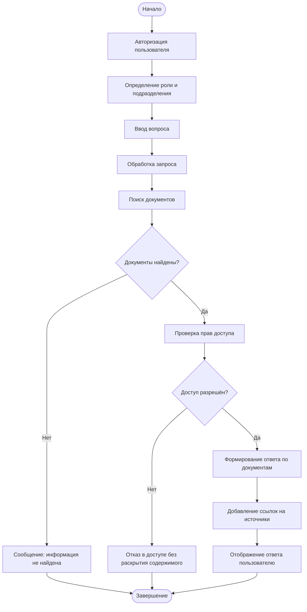

# Пользовательский сценарий Corporate Knowledge Search

## Основной сценарий

## Результат сценария

Пользователь получает ответ на свой вопрос на основании доступных ему корпоративных документов. Ответ сопровождается ссылками на источники. Если информации нет или доступ запрещён, система сообщает об этом без раскрытия закрытых сведений.
